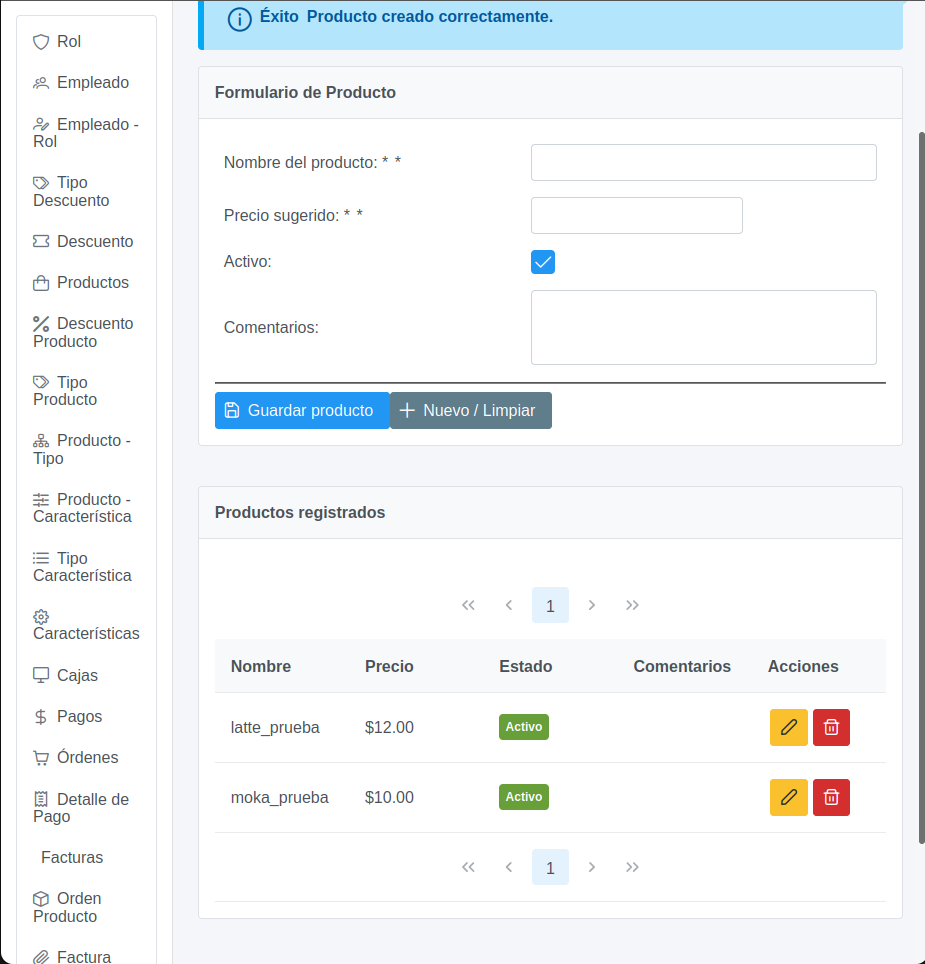
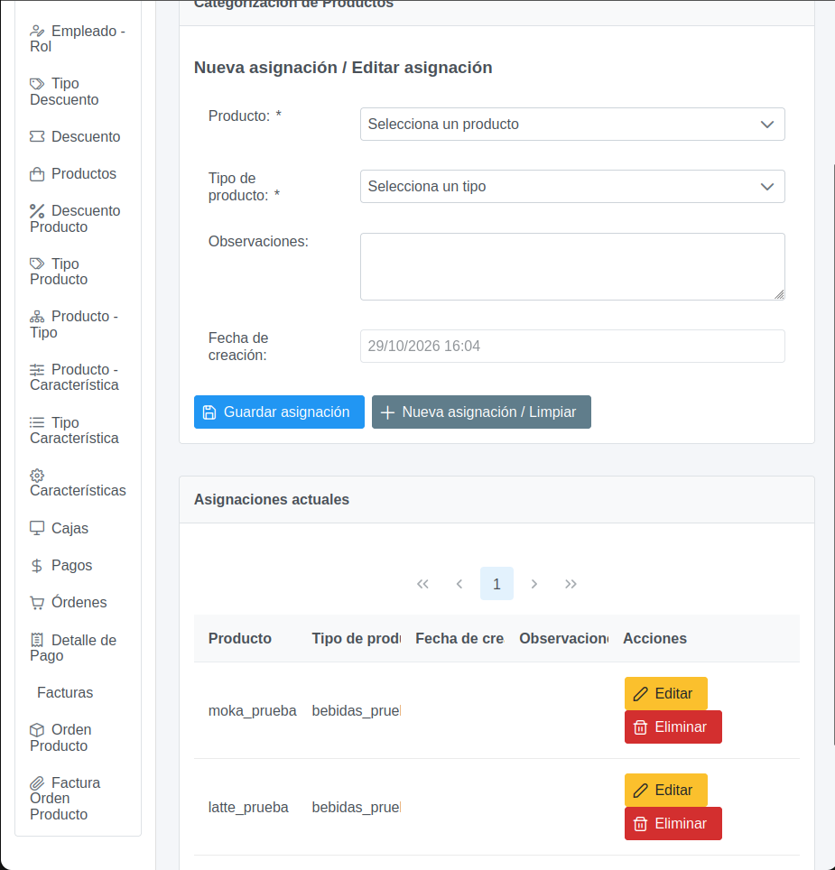
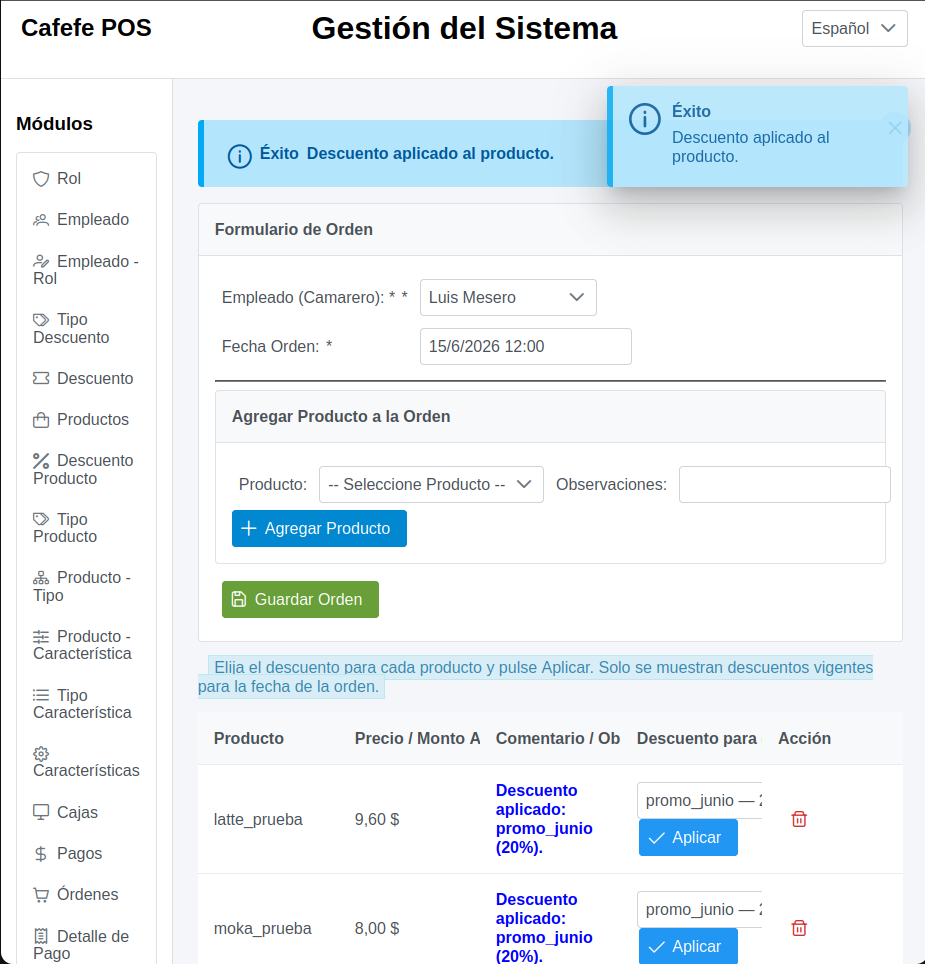

# Busco feedback sobre un POS de cafetería hecho con Jakarta EE y JSF

Hola. Estoy desarrollando un sistema POS para una cafetería como proyecto académico. La aplicación permite administrar productos, asignarles tipos y características, manejar descuentos con vigencia, y crear órdenes para empleados con rol de camarero.

Estoy buscando comentarios técnicos sobre la organización de la UI, la arquitectura de persistencia y el manejo de errores. Adjunto capturas de los formularios y órdenes, además de extractos puntuales del código.

## Interfaz

### Productos



La ficha de Producto permite crear/editar nombre, precio, estado y comentarios. La asociación con un tipo de producto se hace en una pantalla separada:



### Órdenes y descuentos




## Extractos de código

El archivo [code_extracts.md](code_extracts.md) contiene los bloques relevantes de `ProductoBean.java`, `DefaultDAO.java`, `Producto.java` y `<dependencies>` de `pom.xml`.

En el DAO genérico se llama a `EntityManager.persist/merge/remove`, pero no hay límite transaccional explícito en esa clase. Me interesa validar si este diseño es adecuado para el contexto del contenedor y cómo separar mejor validaciones y persistencia.

### `ProductoBean.java`: guardado y validación del tipo

```java
public void guardar() {
    if (registro == null) return;
    if (!esTipoProductoValido()) {
        mensajeError("Debe seleccionar un tipo de producto activo.");
        return;
    }
    if (!esCaracteristicaValida()) {
        mensajeError("El valor ingresado no cumple con la expresión regular requerida.");
        return;
    }
    if (!esDescuentoValido()) return;

    prepararYGuardarProducto();
    mensajeInfo("Producto guardado correctamente.");
    limpiarFormulario();
}

private boolean esTipoProductoValido() {
    return tipoProductoSeleccionado != null
            && Boolean.TRUE.equals(tipoProductoSeleccionado.getActivo());
}
```

### `DefaultDAO.java`: persistencia

```java
@Override
public void create(T entity) {
    EntityManager em = getEntityManager();
    if (em == null) throw new IllegalStateException("EntityManager nulo.");
    if (entity == null) throw new IllegalArgumentException("La entidad a crear no puede ser nula.");
    em.persist(entity);
}

@Override
public T edit(T entity) {
    EntityManager em = getEntityManager();
    if (em == null) throw new IllegalStateException("EntityManager nulo.");
    if (entity == null) throw new IllegalArgumentException("La entidad a editar no puede ser nula.");
    return em.merge(entity);
}
```

### `Producto.java`: mapeo JPA

```java
@Entity
@Table(name = "producto")
public class Producto implements Serializable {
    @Id
    @Basic(optional = false)
    @NotNull
    @Column(name = "id_producto")
    private UUID idProducto;

    @NotNull
    @Column(name = "precio_sugerido", nullable = false, precision = 8, scale = 2)
    private BigDecimal precioSugerido;

    @OneToMany(mappedBy = "idProducto", fetch = FetchType.LAZY)
    private List<DescuentoProducto> descuentoProductoList;

    @OneToMany(cascade = CascadeType.ALL, mappedBy = "idProducto")
    private List<ProductoTipoProducto> productoTipoProductoList;
}
```

### `pom.xml`: dependencias de runtime y pruebas

```xml
<dependencies>
    <dependency>
        <groupId>org.primefaces</groupId>
        <artifactId>primefaces</artifactId>
        <version>14.0.0</version>
        <classifier>jakarta</classifier>
    </dependency>
    <dependency>
        <groupId>jakarta.platform</groupId>
        <artifactId>jakarta.jakartaee-api</artifactId>
        <version>${jakartaee}</version>
        <scope>provided</scope>
    </dependency>
    <dependency>
        <groupId>org.postgresql</groupId>
        <artifactId>postgresql</artifactId>
        <version>42.7.4</version>
    </dependency>
    <!-- JUnit Jupiter 5.10.2 y Mockito 5.11.0 están en scope test. -->
</dependencies>
```

## Preguntas para feedback

1. **UI:** ¿Mantendrían Producto y la asignación Producto–Tipo en pantallas separadas, o integrarían la selección del tipo dentro del formulario del producto?
2. **Arquitectura:** ¿Dónde ubicarían la lógica de validación y las transacciones en una aplicación JSF/JPA: Bean, servicio de aplicación o DAO?
3. **Excepciones:** ¿Cómo estructurarían el manejo de errores de validación y persistencia para mostrar mensajes útiles en JSF sin ocultar la causa técnica?

¡Gracias por cualquier sugerencia!
